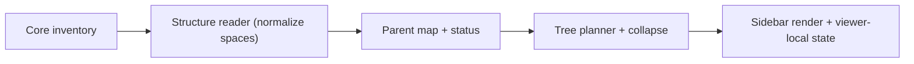

# Worker tree & sidebar orchestration

## Objective

Show parent-derived agent hierarchies and clean workspace lists in `hc-tui` without changing terminal placement, shared Herdr configuration, or `herdr-core` runtime behavior.

## Background

Core already sends `Terminal.parent` and OSC 7501 `Status` (`state`, `kind`, `progress`, `app`, `title`, `msg`). Existing agent rows require live reporting programs, so a shell or finished parent can be absent from the list. Projection caches are per endpoint, while parent chains can cross endpoints and hidden terminals. When panes are closed in `Herdr.app` or via `hc kill`, `herdr-core` retains them as `state = "finished", reason = "killed"` while `Herdr.app` removes them from its layout document; opaque `sp...`/`tb...` space IDs also surface on fallback terminals.

## Design

Tree mode auto-enables whenever any inventory terminal reports a `parent` ID (`agent_tree_auto = true` by default on CLI launch). `--agent-tree` forces tree mode on and `--no-agent-tree` forces flat mode; live config reload preserves both flags and never writes to shared Herdr configuration. [D1]

Projection builds a shared parent map from the full inventory after endpoint cache lookup. Each snapshot references the same immutable map. Hidden and non-agent terminals remain available as ancestry intermediates. Parent IDs match terminal IDs exactly; unknown aliases become roots.

The planner (`agent_tree::plan_with_status`) consumes the existing flat ranking and returns row indices, depth, sibling position, ancestor guide bitmask, and bottom-up `TeamSummary` counts. `apply_collapse` filters descendants of collapsed parent IDs so expanded rendering, mouse hits, and `Alt+Up`/`Alt+Down` navigation agree. Collapsed parent IDs persist in the viewer-local chrome preferences file (`$XDG_STATE_HOME/hc-tui/client-shell/*.json`) and prune missing terminal IDs on inventory refresh. [D2, D3]

Space normalization stays in `structure/reader.rs` and `project.rs`: unattached `finished` + `killed` terminals are skipped so closed `Herdr.app` panes never resurrect as ghost spaces, opaque `sp`/`tb`-prefixed hex, 32-char hex, UUID, and 6+ digit IDs fall back to repo/folder names while keeping their grouping key, and unnamed fallback terminals merge into matching `herdr-app` folder spaces. Multi-endpoint sidebars label their header `spaces` to match `Herdr.app`. [D4]

## Detailed design

Resolve each visible agent to its nearest visible ancestor through the parent map. Stop on missing records or repeated IDs, then break cycles in the compressed visible graph by clearing the parent link of the lexicographically smallest canonical ID in each cycle. Rank each subtree by the best original flat rank among its members and emit depth-first with the parent before its children. Traversal is iterative; visual depth is bounded to 3 independently of tree depth.

Expanded rows draw continuous `│`, `├─`, and `└─` guides in muted `overlay0` across multi-line rows and nested siblings. Child rows sharing their parent's workspace drop the redundant workspace prefix and promote their task/tab name to primary bold weight; duplicate single-token second-line agent names are omitted. [D1]

On line 0, right-aligned badges show OSC 7501 `kind` (`perm`/`ask`/`auth`) or `progress` (`%`) on active/blocked rows, a clickable `▾` chevron on expanded parents, and a rolled-up `▸ N! M●` `TeamSummary` badge on collapsed parents (with a 2-column breathing reserve so truncated titles never collide). Clicking `▾`/`▸` or pressing `Ctrl+B t` toggles collapse and persists `collapsed_agents` to the viewer-local preferences file; `refresh_projection` prunes any collapsed ID absent from live inventory and re-persists on change. [D2, D3]

## Decisions recorded

- **D1 — Enablement (chosen: Auto-enable when workers have parent):** Tree mode activates automatically whenever `!snapshot.terminal_parents.is_empty()`; `--agent-tree` and `--no-agent-tree` override it explicitly. *Reopen if:* unexpected flat-mode regressions appear when parent links exist.
- **D2 — Collapse persistence (chosen: Persist in viewer-local cache file):** `collapsed_agents` is stored in `ClientChromePreferences` under `$XDG_STATE_HOME/hc-tui/client-shell/` and pruned on inventory refresh. *Reopen if:* cross-viewer collapse sync is needed.
- **D3 — Status & team badges (chosen: Show roll-up badges mainly when collapsed):** `agent_tree.rs` computes `TeamSummary` bottom-up and renders compact roll-up badges (`▸ 1! 2●`) on collapsed parent rows, keeping expanded parent rows uncluttered (`▾`). *Reopen if:* expanded parent headers also need live descendant counts.
- **D4 — Space normalization (chosen: Keep normalization in `structure/reader.rs`):** Skip unattached `finished · killed` terminals, resolve `sp`/`tb` hex and other opaque IDs to folder/repo names in `project.rs`/`reader.rs`, and merge duplicate folder spaces. *Reopen if:* `herdr-core` begins pruning killed records automatically.

## Verification

Tests cover forest ordering, cycles, deep chains, ancestor guide alignment, `TeamSummary` rollups, collapse filtering, opaque space ID fallbacks, CLI parsing, reload preservation, real-binary fake-core PTY (`agent_tree_e2e`), and official-core PTY (`agent_tree_real_core`). Visual verification uses the 4-step Ghostty screenshot flow against an isolated scratch `hc 0.1.21` session.
