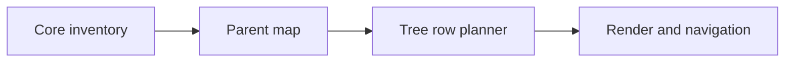

# Optional worker tree

## Objective

Implement the [agent-tree requirements](intent.md) without changing terminal placement or runtime behavior.

## Background

Core already sends `Terminal.parent`. Existing agent rows require live reporting programs, so a shell or finished parent can be absent from the list. Projection caches are per endpoint, while parent chains can cross endpoints and hidden terminals. Rendering and navigation share aggregate row ordering. The old flat ordering also drives receipt allocation and must not be changed globally.

## Design

Enable the always-expanded tree with `hc-tui --agent-tree`. The option belongs to this viewer, survives live config reload, and is not written to shared Herdr configuration. Omitting it preserves the existing flat behavior. [D1]

Projection builds a shared parent map from the full inventory after endpoint cache lookup. Each snapshot references the same immutable map. Hidden and non-agent terminals remain available as ancestry intermediates. Parent IDs match terminal IDs exactly; unknown aliases become roots. No hostname inference is added. [D2]

The planner consumes the existing flat ranking and returns row indices, depth and sibling position. It changes neither snapshot agent order nor state used by completion receipts. Aggregate tree planning runs once after cross-endpoint priority sorting. Single-endpoint views use the same planner. Workspace rows retain their original flat order. The Agents portion of the collapsed sidebar uses the tree order so its numbers match indexed focus. [D3]

## Detailed design

Resolve each visible agent to its nearest visible ancestor through the parent map. Stop on missing records or repeated IDs. Then break cycles in the compressed visible graph by clearing the parent link of the lexicographically smallest canonical ID in each cycle. This second check handles cycles that pass through invisible terminals.

Rank each subtree by the best original flat rank among its members. Sort roots and sibling subtrees by that rank, then emit depth-first with the parent before its children. A blocked child can lift its family without changing the parent's status. Traversal is iterative; visual depth is bounded independently of tree depth. [D3]

Rows for shell parents are never invented. Several agents launched by a shell without an agent ancestor remain separate roots. A missing parent never hides a child. Known stale parents remain visible and dimmed; keyboard targets continue to skip offline endpoints using indices from the rendered list. Multiple status records in one terminal do not create child rows. [D2, D3]

Expanded rows use `├─` and `└─` connectors with bounded indentation. Deeper rows use blank ancestor padding rather than vertical continuation guides. Collapsed lists use tree order without connectors. Mobile uses a width-bounded prefix. Existing focus-reveal behavior works from the final row indices. Every mouse target keeps the real endpoint and terminal address. Indexed focus refers to the displayed tree row when the option is enabled. Tree mode omits rows without a matching workspace, the same eligibility check used by the row renderer; flat mode keeps its existing path. [D4]

The tree performs no RPCs. Reconnect snapshots rebuild it through ordinary projection. No tree state is persisted. A config reload must explicitly preserve the CLI mode when rebuilding shell configuration. [D1, D2]

## Alternatives considered

- D1, enablement: choose a session-only CLI option. Shared config keys can produce warnings in old Herdr; persistence and an in-app toggle are deferred.
- D2, ancestry transport: choose one projection-wide immutable parent map. Pane-only maps miss hidden intermediates; per-agent ancestry vectors duplicate data and complicate cross-endpoint caching.
- D3, priority: choose the best member's original rank. Root-only ranking can bury urgent workers. Parent status remains unchanged. Reopen if family movement proves confusing.
- D4, expansion: choose always-expanded rows with no new keys. Collapse adds hidden-focus and persistence rules that are not needed for this first version.

## Verification

Tests cover pure forest ordering and cycles, deep chains, shell intermediates, remote workers, stale endpoints, projection cache refresh, render and keyboard target agreement, narrow and collapsed lists, CLI parsing, and reload preservation. The PTY check exercises the actual binary against an isolated fixture. Full parity requires the documented Linux reference harness; macOS checks do not replace that run.

See `docs/parity.md` for the opt-in presentation exception. Tree mode does not solve missing agent status or change shared focus and zoom.
